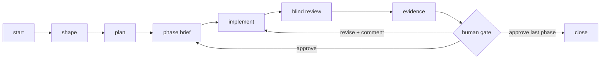

# Cycles

!!! warning "Not released yet"
    The cycle backbone and the phase loop are built on the development branch and not in a release yet.
    Sections tagged <small>built</small> work there today; sections tagged <small>planned</small> don't
    exist yet. Until the release, use the [story loop](workflow.md#the-story-loop-shipped).

A **cycle** is one piece of work bigger than a story: a feature build, a client milestone, a migration.
It lives in a dated folder, it's split into phases, and every phase ends with evidence and a human
decision. The aim is outcomes you can trust because each step is grounded in something checkable
(a test run, a hashed review, a screenshot tied to the exact diff), not in an agent saying it's done.

You own **what** gets built and **whether it's right**. Agents own **how**.

## The shape of a cycle



## Tiers <small>built</small>

Not every cycle needs every step. Each cycle declares a tier, and the gates scale to it:

| Tier | Use it for | What's required |
|---|---|---|
| `summary-only` | Small fixes that still deserve a record | `summary.md`; no phases; closes any time |
| `standard` | Internal features | + at least one phase, each with a brief, a passing blind review, current evidence and your approval |
| `client` | Work a client sees or signs off | + an internal and a client report for each phase, written when you approve it; the cycle can't close without them |

## Where cycles live <small>built</small>

Cycles live in a **meta repo**: one per client or product family, sitting beside the code repos.

```
~/work/acme/
  acme-app/          # code only
  acme-marketing/    # code only
  acme-meta/         # the work about the code, shared with the team in git
    cycles/
    brand/           # optional: logo, fonts, design system
    strategy/        # optional: customer profile, positioning
```

Why a separate repo:

- **Agents opening the code see only the code** as it stands today, not plans, mockups or decisions
  from work that's finished or abandoned.
- **Internal notes stay out of client-owned repos.** Decisions, internal reports and review findings
  never land in a repo the client has access to.
- **Several repos, one place.** Cycles for the app and for the marketing site sit side by side. Each
  cycle covers one code repo (the one it was started in); work that changes both is two cycles.

**Mirrored to your notes vault.** Each cycle is also copied to your Obsidian vault (`cycles.mirror`), so
it's searchable next to your other notes. The copy flows **one way**, meta repo → vault: at every phase
gate, on `close`, and on demand with `sync`. Each mirrored markdown file starts with a line saying
where it came from; nothing in the mirror is ever edited there (the next sync replaces it), so there's
only ever one place to change a cycle.

**Small solo project?** Leave `cycles.dir` unset and cycles go in `.claude/cycles` inside the code
repo. Anywhere else inside the code repo is refused: cycle files there would count as code changes in
every review and evidence check.

```jsonc
// .claude/harness.json in acme-app
"cycles": {
  "dir": "../acme-meta/cycles",        // default ".claude/cycles"
  "mirror": "~/notes/acme/cycles",     // optional: your Obsidian vault folder
  "deny": ["AcmeCorp", "Project Falcon"] // optional: removed from client reports
}
```

A symlinked cycle folder or vault copy is refused rather than followed, and a sync builds the new copy
beside the old one before swapping it in, so a failed sync leaves the previous copy intact.

Open the meta repo alongside the code (`claude --add-dir ../acme-meta`) so agents can read and update
the cycle; a cloud environment clones both.

```
acme-meta/cycles/2026-10-14-acme-invoicing/
  summary.md        # required, living: tier, status, current phase, next action, learnings
  decisions.md      # every locked decision, dated, one line each + why
  plan.md           # optional: the plan; in scope / NOT building
  roadmap.yaml      # optional: phases with done-when criteria and dependencies
  phases/1-invoice-model/
    brief.md        # what this phase builds, done-when, evidence required
    review.json     # blind-review artifact, tied to the diff's hash
    evidence/       # screenshots + manifest.json, tied to the diff's hash
    approval.json   # the human gate, written by cycle_approve.sh
```

The files are the contract, and a cycle still makes sense with **no hooks at all** (a cloud VM, a
teammate's different tooling). `cycle.sh` itself enforces phase order, the tier rules, and that an
approval matches the review and evidence it approved. What it can't check is *who* ran the approval
tool; where the hook isn't running, that rests on the approval tool's terminal check alone.

## Commands <small>built</small>

Ask Claude in plain words ("start a cycle for Acme invoicing", "continue the current phase"); the
`cycle` skill runs these steps.

- **`start <slug>`** creates the dated folder and a first `summary.md`.
  `start <slug> --from <file>` imports scope you already shaped elsewhere.
- **`shape`** is an interview, one question at a time, each with a recommendation and alternatives. It
  asks whether this should be built at all, and builds a "not building" list. Every answer becomes a
  dated line in `decisions.md`, so the decisions are the record of the interview. Where it would have to
  guess, it stops and asks.
- **`plan`** writes `plan.md` and `roadmap.yaml`, with done-when criteria for every phase. A cycle whose
  first usable version is the goal gets a **rework phase** after it: matching the spec isn't the same as
  being right, and you only find out by using it.
- **`resume`** picks up the open cycle: reads its summary, decisions, plan and roadmap, and continues the
  current phase. This is how a new session (or a new agent) gets back into the work. With more than
  one cycle open, it asks which.
- **`close`** writes the final summary, drafts the release notes or client update, marks the cycle
  closed and mirrors it one last time. The folder stays in the meta repo as history.
- **`sync`** mirrors the meta repo's cycles to your vault on demand.

Underneath, the skill uses `tools/cycle.sh` (run from the code repo):

| Command | Does |
|---|---|
| `start <slug> [--tier …] [--from <file>]` | Creates the dated cycle folder |
| `phase <slug> [<cycle>]` | Starts the next phase; refused until the previous one is approved |
| `status [<cycle>]` | Tier, status, each phase's decision and any revise comment |
| `evidence [stamp] [<cycle>]` | Checks the current phase's evidence, or ties it to the current diff |
| `report [<cycle>] [<phase>]` | Writes the internal and client reports for an approved phase |
| `close [<cycle>]` / `sync [<cycle>]` | Closes (all phases approved) and copies to the vault |

!!! note "Planned: `cycle_lint`"
    A lint that checks a whole cycle folder (required summary sections, ordered phases, done-when items
    in every brief, decisions never silently contradicted) and lets the pipeline gate accept a phase
    brief in place of a story.

## The phase loop <small>built</small>

Each phase runs the same loop, and every step leaves something a machine can check.

| Step | What happens | What makes it trustworthy |
|---|---|---|
| **Brief** | The phase's scope, done-when criteria and required evidence | Evidence is checked item by item against the brief's **Done when** list |
| **Implement** | Your agents build it | The Stop gate runs the tests through the shared lock |
| **Review** | `blind-review` of everything since the phase began (committed or not): the reviewer gets the diff, the standards and the done-when list, never the implementer's story | Measured from the commit the phase started at, so committing the work can't hide it; tied to the diff's hash; findings must cite changed lines; it also flags work **outside the brief** |
| **Fix loop** | A critical finding becomes the implementer's next task | Any edit makes the review stale, so re-review is forced |
| **Evidence** | Each done-when item gets the test or screenshot that proves it, plus how to open the running app | `evidence/manifest.json`, stamped with the diff's hash; any later edit makes it stale |
| **Human gate** | You use the result and decide | `approval.json`, written only by `cycle_approve.sh` in your terminal |

### Evidence is three states, never two

Each done-when item is **`verified`**, **`failing`** or **`could-not-verify`**. Browser automation is
wrong often enough, in both directions, that "the agent couldn't check" must never read as "it passed".
A screenshot is evidence for **you**; it never closes a gate by itself.

```json
{"open_app": "bin/dev, then http://localhost:3000/invoices/1",
 "items": [
   {"done_when": "Totals round to the cent", "status": "verified", "proof": "test/models/invoice_test.rb:12"},
   {"done_when": "The PDF matches the screen", "status": "could-not-verify", "proof": "evidence/pdf.png"}]}
```

A `failing` item, a done-when item with no entry, a missing proof file or a missing `open_app` all
keep the evidence incomplete.

### The human gate

When Claude says a phase is ready, run this **in your own terminal**, from the code repo:

```sh
bash <harness>/tools/cycle_approve.sh
```

It shows the brief, what changed in the code since the phase began (and warns if nothing did),
re-checks the review and the evidence against the current diff, asks whether you used the result,
then asks for your decision:

- **approve**: the phase closes and the next brief can start;
- **revise**: leave a comment; the agent revises and presents again;
- **reject**: the phase goes back to its brief.

**approve** is only offered when the review passes and the evidence is complete and current;
approving something you haven't used asks you to confirm. **revise** and **reject** need a comment,
which `cycle.sh status` shows to the agent. The decision, your name, the time, the review verdict and
hashes of the review and evidence are recorded in the phase's `approval.json`, with earlier decisions
kept in its history. What gets approved is exactly what you were shown: if the brief, review or
evidence changes while you're deciding, approve is refused and you run it again to see the new version.

`cycle.sh` only counts an approval that matches what was approved: it names this cycle and phase, an approver
and a time, a passing review, and hashes equal to the phase's current brief, `review.json`, evidence
manifest and evidence files. A revise or reject record keeps what you saw separately, so editing its
decision to "approve" doesn't make it one. A hand-written `{"decision": "approve"}`, an approval copied from another phase or cycle, or one whose
review or evidence changed afterwards (including a replaced screenshot) shows as
`approve-unverified` and unlocks nothing. Run the approval tool again: for the phase in progress you
decide afresh; for an earlier phase (its code is history) it shows exactly which file changed and
asks you to re-confirm the approval as the files now stand, with a reason, or to restore those files
from the meta repo's git history instead. Once a phase is approved its evidence is frozen: `cycle.sh evidence stamp` refuses to re-stamp
it. And the code must stay as reviewed: if anything changes after you approve a phase, the next phase
won't start (and the cycle won't close) until that phase is re-reviewed and you approve it again. The
next phase also waits until the reviewed work is committed, so the commit it starts from is exactly
the code that was reviewed.

!!! tip "Keep cycles in git"
    Recovering an earlier phase whose files were overwritten means restoring them, from the meta repo's
    git history or from the vault mirror. Commit the cycle folder as you go (or set `cycles.mirror`).

**What stops an agent approving its own work:** the tool refuses to run without a terminal or inside
Claude's tools (which have none, and are marked by `CLAUDE_CODE_CHILD_SESSION`), and the `cycle_guard`
hook denies agent commands that run it or write `approval.json` (reading it is fine). Together with the
hash check, that stops an agent taking a shortcut. It is not proof against an agent deliberately
disguising what it runs or forging matching hashes; for that level of assurance, pair it with a
human-only git signal such as a signed tag or a PR approval.

### Client reports

For `client` tier cycles, approving a phase writes two markdown reports next to it:

- **internal**: what was built, the evidence, the review verdict and findings, who approved it and their
  comment;
- **client**: what was delivered and how each done-when item was checked, with every `cycles.deny`
  string replaced by `▇▇▇` (case-insensitive, even when a name is wrapped across lines). No findings, comments or names. If a deny string survives, the
  client report is removed and the command fails.

!!! note "Planned: `qa-report` rendering"
    Rendering these through the `qa-report` tool (HTML and PDF, its own approval flow) when it's
    installed.

## Standards and learning <small>planned</small>

- **Standards** live in one place in the repo and are looked up when needed, not copied into every
  skill. The implementer and the reviewer get the same standards.
- **Learnings are proposed, then approved.** When the same kind of correction comes up again, the agent
  proposes a learning. Nothing becomes a standing rule until a human accepts it.
- **The same review finding in two cycles proposes a standard.** A repeat means the fix is structural,
  not "be more careful".
- **Closing a cycle writes its root-cause notes** from the review findings and gate failures (what was
  wrong before it shipped, what caught it, what now prevents it), not from memory.
